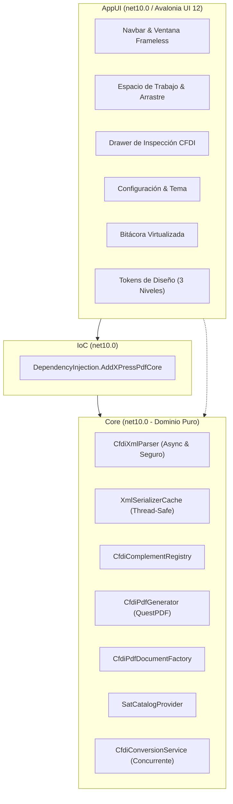

# Guía de Contribución para XPress PDF

¡Gracias por tu interés en contribuir a **XPress PDF**! 🎉

Este proyecto es una solución de alto rendimiento desarrollada en **.NET 10** y **C# 14**, diseñada bajo principios de arquitectura limpia (*Clean Architecture*), código desacoplado y una experiencia de usuario moderna con **Avalonia UI 12**.

Tanto si vas a reportar un error, incorporar el soporte de un nuevo complemento del SAT, optimizar la generación de PDF con QuestPDF o mejorar la documentación, esta guía detalla los estándares de ingeniería y gobernanza obligatorios en la organización.

---

## 🏛️ 1. Arquitectura y Principios de Código Limpio

La solución se estructura en tres capas con responsabilidades estrictamente delimitadas:



### 1.1 Pureza de Dominio en `Core`
- **Sin dependencias de interfaz**: El proyecto `Core` no contiene referencias a Avalonia, ventanas ni controles gráficos.
- **Seguridad en deserialización XML**: `CfdiXmlParser` prohíbe DTDs (`DtdProcessing.Prohibit`) y opera de manera asíncrona sobre flujos binarios.
- **Cero penalización por recompilación**: Toda deserialización reutiliza `XmlSerializerCache` para evitar costos dinámicos en memoria.
- **Extensibilidad modular**: Los complementos del SAT implementan `ICfdiComplement` o `ICfdiConceptComplement` y se renderizan mediante componentes desacoplados `ICfdiComplementSectionRenderer`.

### 1.2 Cómo agregar un nuevo complemento del SAT
Para incorporar un nuevo complemento oficial del SAT, sigue 3 pasos:
1. **Modelos**: Genera o declara las clases C# en `Core/Models/Complements/<NombreComplemento>/` implementando `ICfdiComplement`.
2. **Registro**: Regístralo en [CfdiComplementRegistry.cs](file:///c:/Users/Jorge%20Silva/source/repos/XPressPDF/Core/Xml/CfdiComplementRegistry.cs) con su espacio de nombres y nombre local XML.
3. **Renderizado**: Crea su clase en `Core/Pdf/ComplementRenderers/` implementando `ICfdiComplementSectionRenderer` y regístrala en [DependencyInjection.cs](file:///c:/Users/Jorge%20Silva/source/repos/XPressPDF/IoC/DependencyInjection.cs).

### 1.3 Modismos Modernos de C# 14 y .NET 10
* **Espacios de nombres con ámbito de archivo**: `namespace Core.Pdf;`.
* **Constructores primarios**: en clases y registros siempre que simplifiquen la inyección de dependencias.
* **Expresiones de colección**: utiliza `[...]` en lugar de `new List<T>()` o `new T[] { ... }`.
* **Inmutabilidad en la ruta de datos**: objetos de opciones y resultados se definen como `record` (`CfdiConversionOptions`, `CfdiConversionResult`, `CfdiConversionProgress`).
* **Concurrencia cooperativa**: procesamiento por lotes sobre `Parallel.ForEachAsync` respetando siempre `CancellationToken`.

---

## 🛠️ 2. Configuración Inicial del Entorno

### Requisitos Previos
1. **[.NET 10 SDK](https://dotnet.microsoft.com/download)** (versión 10.0.100 o superior).
2. **[Git](https://git-scm.com/)** (versión 2.30 o superior).
3. **[git-flow-next](https://github.com/gittower/git-flow-next)** (extensión oficial en Go).

```bash
# Windows (WinGet)
winget install GitTower.GitFlowNext

# Windows (Scoop)
scoop install git-flow-next

# macOS / Linux (Homebrew)
brew install gittower/tap/git-flow-next
```

### Inicialización Automatizada en un Solo Paso
Tras clonar el repositorio, ejecuta el script de aprovisionamiento según tu sistema operativo:

```powershell
# En Windows (PowerShell)
.\scripts\setup-gitflow.ps1
```

```bash
# En macOS o Linux (Bash)
chmod +x ./scripts/setup-gitflow.sh
./scripts/setup-gitflow.sh
```

El script configura automáticamente las **10 claves normativas** de GitFlow en tu repositorio local:
* Prefijos estandarizados (`main`, `develop`, `feature/`, `bugfix/`, `release/`, `hotfix/`, `support/`, tag `v`).
* Fusiones explícitas sin avance rápido (`no-ff`) para preservar el árbol visual de ramas.
* Mensajes de fusión estandarizados (`chore(merge): integrar %b en %p`).
* Plantilla de confirmación `.gitmessage` en `commit.template`.
* Hook de validación local en `.githooks/commit-msg` mediante `core.hooksPath`.

---

## 🌿 3. Flujo de Trabajo GitFlow-Next (Manual v1.2.0)

El proyecto sigue estrictamente el manual **Flujo de trabajo con GitFlow versión 1.2.0**.

### 3.1 Responsabilidad de cada rama

| Rama | Nace de | Se fusiona en | Propósito y Prefijos de Commit |
|---|---|---|---|
| `main` | — | — | Código en producción. Cada commit es una versión formalmente etiquetada (`v1.0.0`). Solo recibe fusiones. |
| `develop` | `main` | `release/` | Rama de integración de la siguiente versión. Refleja el trabajo más avanzado. |
| `feature/` | `develop` | `develop` | Desarrollo de nuevas funcionalidades (`feat`, `refactor`, `test`, `style`). |
| `bugfix/` | `develop` (o base indicada) | Su rama base | Corrección de defectos detectados **antes** de publicar (`fix`, `test`). |
| `release/` | `develop` | `main` y `develop` | Estabilización, documentación y actualización de `CHANGELOG.md` (`fix`, `docs`, `chore`). |
| `hotfix/` | `main` | `main` y `develop` | Corrección urgente de defectos en código ya publicado en producción (`fix`). |

### 3.2 ¿Cuándo usar `bugfix/` y cuándo `hotfix/`?

La elección de la rama depende exclusivamente de **dónde reside el defecto**, no de su urgencia:

* **Usa `bugfix/`**: Si el defecto está en `develop` o se detectó durante la estabilización de una `release/` no publicada.
* **Usa `hotfix/`**: Si el defecto afecta al código ya publicado en `main` y requiere un parche fuera del ciclo regular.

#### Corrección sobre una rama de versión en curso
Si durante las pruebas de una versión en preparación (ej. `release/1.0.0`) se detecta un defecto, crea la rama con base explícita para que al cerrarse vuelva a esa misma base sin contaminarse con cambios paralelos de `develop`:

```bash
git flow bugfix start correccion-tablas release/1.0.0
# Realizar commits correctivos
git flow bugfix finish correccion-tablas
```

### 3.3 Mensajes de fusión y distinción entre `-M` y `-m`

Al cerrar cualquier rama, GitFlow genera un commit de fusión explícito:
* Formato configurado: `chore(merge): integrar %b en %p`.
* Si requieres personalizar el mensaje de la fusión, usa **`-M`** (o `--merge-message`).
* **Precaución**: No confundir `-M` con `-m`. `-M` define el mensaje del commit de fusión; `-m` define el mensaje de la etiqueta (*tag*) creada al cerrar una `release/` o `hotfix/`.

```bash
# Personalizar el commit de fusión
git flow feature finish exportacion-excel -M "chore(merge): integrar modulo de exportacion a excel"
```

### 3.4 Ciclo completo de trabajo paso a paso

```bash
# 1. Sincronizar develop
git switch develop
git pull origin develop

# 2. Iniciar una feature
git flow feature start renderizado-cartaporte

# 3. Trabajar con commits atómicos (Conventional Commits v2.0.0)
git add Core/Pdf/ComplementRenderers/CartaPorteSectionRenderer.cs
git commit -m "feat(pdf): incorporar renderizado de mercancias en carta porte"

# 4. Cerrar la funcionalidad
git flow feature finish renderizado-cartaporte
git push origin develop
```

### 3.5 Publicación de versiones (`release/`)

```bash
# 1. Iniciar la versión
git flow release start 1.1.0

# 2. Actualizar CHANGELOG.md y documentación
git commit -am "chore(release): actualizar el changelog para la version 1.1.0"

# 3. Cerrar versión (crea fusiones en main y develop, y genera etiqueta v1.1.0)
git flow release finish 1.1.0

# 4. Enviar a remoto asegurando etiquetas anotadas
git push --follow-tags origin main develop
```

### 3.6 Tabla de equivalencias en Git estándar
Para entornos donde no esté instalada la extensión `git-flow-next`:

| Operación | Comando equivalente en Git estándar |
|---|---|
| `git flow feature start x` | `git switch -c feature/x develop` |
| `git flow feature finish x` | `git switch develop && git merge --no-ff -m "chore(merge): integrar feature/x en develop" feature/x && git branch -d feature/x` |
| `git flow bugfix start x release/1.0.0` | `git switch -c bugfix/x release/1.0.0` |
| `git flow bugfix finish x` | `git merge --no-ff -m "chore(merge): integrar bugfix/x en <base>" bugfix/x` |
| `git flow release start 1.0.0` | `git switch -c release/1.0.0 develop` |
| `git flow release finish 1.0.0` | Fusionar con `--no-ff` en `main`, etiquetar `v1.0.0`, fusionar en `develop` y borrar rama |
| `git flow hotfix start 1.0.1` | `git switch -c hotfix/1.0.1 main` |

---

## 📝 4. Convención de Mensajes de Commit (Manual v2.0.0)

Todo mensaje debe apegarse estrictamente a **Conventional Commits 1.0.0** y a las normas corporativas (versión 2.0.0).

### 4.1 Anatomía del mensaje

```text
<tipo>[(<ámbito>)][!]: <asunto>

[cuerpo opcional explicando el porqué, ajustado a 72 columnas]

[pie opcional con metadatos: Refs: TAREA-123 · Closes: #45 · BREAKING CHANGE: ...]
```

### 4.2 Las 5 reglas del asunto
1. **Separador obligatorio `: `**: Dos puntos y un espacio tras el tipo o ámbito. Nunca punto solo.
2. **Verbo en infinitivo**: Escribe en infinitivo como acción sobre el código (`agregar`, `corregir`, `eliminar`, `actualizar`, `simplificar`, etc.). Evita pretéritos (`agregué`) o indicativos (`agrega`).
3. **Minúscula inicial**: La primera palabra comienza en minúscula, salvo nombres propios o acrónimos del código (ej. `CFDI`, `PDF`, `SAT`).
4. **Sin punto final**: El asunto es un encabezado sintético, no una oración cerrada.
5. **Máximo 72 caracteres**: La línea completa (tipo, ámbito, separador y texto) no debe exceder 72 caracteres.

### 4.3 Tipos admitidos en la organización

| Tipo | Propósito | Ejemplo | SemVer |
|---|---|---|---|
| `feat` | Nueva funcionalidad observable | `feat(xml): incorporar parser para complemento carta porte 3.1` | MINOR |
| `fix` | Corrección de un defecto o comportamiento anómalo | `fix(pdf): corregir calculo de margen en tabla de deducciones` | PATCH |
| `docs` | Modificaciones exclusivas de documentación | `docs(readme): actualizar requisitos de instalacion en linux` | — |
| `style` | Formato, espacios, indentación (sin cambios lógicos) | `style(ui): normalizar espaciado en tarjetas de emisor y receptor` | — |
| `refactor` | Reestructuración de código sin alterar comportamiento | `refactor(core): extraer serializador a componente generico` | — |
| `perf` | Optimización enfocada en rendimiento y memoria | `perf(conversion): optimizar reutilizacion de instancias xmlreader` | PATCH |
| `test` | Incorporación o ajuste de pruebas automatizadas | `test(pdf): agregar pruebas de renderizado para facturas pPD` | — |
| `build` | Cambios en compilación, dependencias NuGet o empaquetado | `build(deps): actualizar questpdf a version estable` | — |
| `ci` | Modificación de flujos de trabajo en GitHub Actions | `ci: incorporar matriz multiplataforma en workflow de release` | — |
| `chore` | Tareas de mantenimiento o fusiones GitFlow | `chore(merge): integrar feature/nueva-vista en develop` | — |
| `revert` | Reversión de una confirmación previa | `revert: revertir ajuste de interlineado en nomina` | Según el commit |

### 4.4 Ámbitos recomendados del repositorio
`core`, `xml`, `pdf`, `catalogs`, `ioc`, `ui`, `navbar`, `settings`, `diagnostics`, `brand`, `scripts`, `ci`, `docs`, `release`, `merge`.

### 4.5 Cambios incompatibles (`BREAKING CHANGE`)
Si un cambio rompe compatibilidad hacia atrás, **la organización exige ambos elementos juntos**:
1. El signo `!` inmediatamente después del tipo y ámbito.
2. El pie explicativo en mayúsculas `BREAKING CHANGE:` en el cuerpo del mensaje detallando la estrategia de migración.

```text
feat(core)!: reestructurar interfaz icfdipdfgenerator

BREAKING CHANGE: El metodo GenerateBytes ahora requiere un objeto
CfdiConversionOptions no nulo. Consulte la guia de migracion en docs/.
```

### 4.6 Reversiones de commit
No utilices el mensaje predeterminado de Git. Reescribe el commit como:
```text
revert: revertir ajuste de interlineado en comprobante de nomina

Refs: 5e5aa16
```

---

## 📋 5. Lista de Verificación (Checklist) para Pull Requests

Antes de solicitar la revisión de tu Pull Request, verifica:

- [ ] **Compilación limpia**: `dotnet build XPressPDF.slnx -c Release --no-restore -warnaserror` finaliza con **0 errores y 0 advertencias**.
- [ ] **Aislamiento arquitectónico**: Ninguna dependencia de interfaz de usuario fue introducida en `Core`.
- [ ] **Mensajes de commit normativos**: Cada confirmación cumple con Conventional Commits v2.0.0 (infinitivo, minúscula, sin punto, máx. 72 caracteres).
- [ ] **Hook local verificado**: `.githooks/commit-msg` aprueba todos los commits locales.
- [ ] **Rama base correcta**: Si es una nueva funcionalidad, el PR apunta hacia **`develop`**. Si es un hotfix de producción, apunta hacia **`main`**.
- [ ] **Documentación actualizada**: Si agregaste parámetros o complementos, actualizaste los comentarios XML y el `README.md` o `CHANGELOG.md` correspondiente.
